# Arquitectura y concatenación

## Mapa de integración (obligatorio)

```mermaid
flowchart LR
  TG[Telegram /nuevo /estado /aclarar · botones] --> TT[Telegram Trigger<br/>entrada única]
  V[Panel en GitHub Pages<br/>widget ElevenLabs] --> EL[Agente de voz Andrea]
  EL -- herramienta webhook<br/>x-valoria-key --> WV[Webhook voz]
  TT --> N[Normalizar y validar entrada<br/>guardrails]
  WV --> N
  N --> D[Dedupe<br/>valoria_eventos]
  D --> R{Ruta}
  R -- nuevo/aclarar --> C[Crear/actualizar caso<br/>valoria_casos] --> O[Orquestador]
  O --> S[Descargar skills de Pages<br/>adaptador + huella]
  S --> A1[A1 Intake] --> A2[A2 Datos] --> A3[A3 Propuesta] --> A4[A4 Revisión]
  A4 -- devuelto, iter<3 --> A3
  A4 -- aprobado --> X[Cerrar caso: estado, costos, traza]
  X --> AP[Telegram: aprobación con botones caso/versión]
  AP -- callback --> TT
  R -- decisión --> DV[Validar decisión<br/>asesor + versión + plazo] --> UP[Actualizar caso]
  R -- estado --> ES[Leer registro] --> RESP[Telegram o respuesta a la voz]
  X --> EXP[Webhook export sanitizado]
  EXP --> GIT[commit] --> GA[GitHub Actions<br/>pruebas + escaneo] --> GP[GitHub Pages]
```

Un mismo `caso_id` (`VAL-AAMMDD-XXXX`) aparece en: el acuse de Telegram o la respuesta de voz, `valoria_eventos`, `valoria_casos`, cada fila de `valoria_costos` (`llamada_id = caso_id-Lnn`), cada paso de `valoria_traza`, el `callback_data` de los botones (`ap|caso_id|versión`), la exportación sanitizada y la tabla del panel.

## Roles: qué recibe cada uno del anterior y por qué es necesario

| Rol | Recibe | Entrega | Por qué es necesario | Permisos |
|---|---|---|---|---|
| Orquestador (código) | Evento normalizado, reglas de los skills | Plan, estados, cierre honesto, costos y traza | Orden fijo, auditable y barato; controla presupuesto, iteraciones y tiempo | Leer/escribir tablas; no llama al LLM |
| A1 Intake (LLM + validación) | Texto enmascarado | Requerimiento estructurado o aclaración | Convierte lenguaje natural en campos; el código decide si son válidos | Solo el texto del caso |
| A2 Datos (LLM + verificación) | Requerimiento + elegibles filtrados por reglas | Selección de IDs con justificación, o insuficiencia | Elegir entre candidatos según el objetivo requiere interpretación; el código impide IDs inventados | Solo catálogo ficticio |
| A3 Propuesta (código + LLM) | Selección verificada (+ correcciones) | Cálculo determinista + resumen, supuestos, riesgos | Separa cifras verificables (código) de explicación (LLM) | Funciones de cálculo, 1 llamada |
| A4 Revisor (código + LLM) | Requerimiento, cálculo, redacción | Aprobado o devuelto con correcciones | Último control antes del humano; R1–R10 en código vencen al LLM | Solo lectura |
| Asistente de voz | Conversación | Llamadas `crear_caso` / `consultar_caso` | Interfaz adicional; no sustituye a ningún agente | Solo los dos endpoints, datos ficticios |

## Contratos
- Entrada: `agentes/contrato_entrada.schema.json` (caso_id, canal, usuario seudónimo, objetivo, datos, modo, límite de costo).
- Salida: `agentes/contrato_salida.schema.json` (caso_id, agente, estado, resultado, fuentes, advertencias, duración, `llamada_id`).
- Prompts: `agentes/*.md` (sección "System prompt"; el generador los copia a n8n).

## Tablas privadas (n8n Data Tables)
Ver `datos/diccionario_datos.md`.

## Decisiones de diseño
1. **Todo en un workflow principal**: evita referencias entre workflows que se rompen al importar (IDs distintos) y deja una sola entrada Telegram.
2. **Código fuente fuera de n8n** (`n8n/fuentes/`, `agentes/*.js`) y JSON generado: el mismo cálculo se prueba en Actions y la prueba verifica que la copia en n8n sea idéntica.
3. **HTTP Request a la API de Anthropic** (no nodo de agente): da `usage.input_tokens/output_tokens` exactos para el registro de costos y control fino de reintentos.
4. **Skills cargados en tiempo de ejecución desde Pages** con huella en la traza: demuestra uso real del archivo, no una copia pegada.
5. **Vencimiento perezoso**: el plazo de aprobación se evalúa al pulsar el botón o consultar el estado (sin workflows programados extra).
